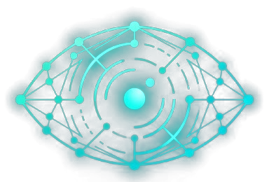
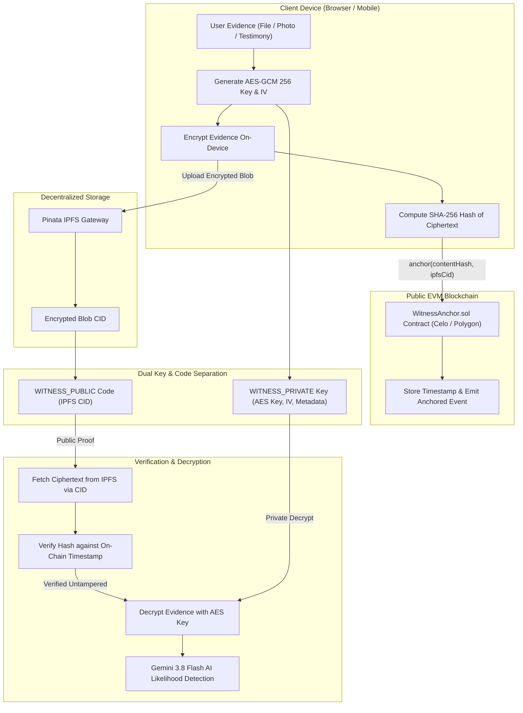

<h1 align="center">Witness</h1>

<p align="center">
  
</p>

<h2 align="center"><strong>Zero-Trust Evidence Anchoring Protocol with Multi-Chain Timestamping & On-Device Cryptography.</strong><br> Your evidence. Your keys. Immutable proof.</h2>

<details>
<summary style="font-size: 24px; font-weight: bold; cursor: pointer;"><h1>Table of Contents</h1></summary>

- [Architecture Diagram](#architecture-diagram)
- [Demo Video](#demo-video)
- [The Problem](#the-problem)
- [Our Solution](#our-solution)
- [What Gets on the Blockchain?](#what-gets-on-the-blockchain)
- [Two Codes and the Cryptographic Process](#two-codes-and-the-cryptographic-process)
  - [1. Public Verification Code (WITNESS_PUBLIC)](#1-public-verification-code-witness_public)
  - [2. Private Decryption Key (WITNESS_PRIVATE)](#2-private-decryption-key-witness_private)
  - [Cryptographic Process (High Level)](#cryptographic-process-high-level)
- [Offline-First Resilience](#offline-first-resilience)
- [AI Detection Integration](#ai-detection-integration)
- [Tech Stack](#tech-stack)
- [Installation & Setup Guide](#installation--setup-guide)
  - [1. Prerequisites](#1-prerequisites)
  - [2. Frontend Setup](#2-frontend-setup)
  - [3. Smart Contract Setup & Deployment](#3-smart-contract-setup--deployment)
- [Deployment](#deployment)
- [Team Members](#team-members)
- [License](#license)

</details>

## Architecture Diagram



## Demo Video

[[Watch Demo Video]](https://github.com/user-attachments/assets/a5dd2a68-bbc2-43a5-8e3d-8677ed6bb03e)

## The Problem

Activists, journalists, human rights investigators, whistleblowers, and conflict victims routinely face a critical dilemma when documenting evidence:

- **Centralized cloud platforms** can be subpoenaed, censored, pressured, hacked, or manipulated. Storing evidence with centralized intermediaries also puts the uploader at severe risk of being identified and targeted by hostile regimes.
- **Local storage** provides zero evidentiary weight. Anyone can claim a piece of evidence (a leaked document, casualty report, damage photo, or eyewitness testimony) was altered, generated by AI, or backdated after the fact.
- **Fragility of paper & physical records** means war crimes go undocumented in a court-admissible format, whistleblowers get dismissed as "unverifiable," and disaster victims cannot prove loss or property claims to insurers and relief agencies after records are destroyed.

Witness bridges this gap without relying on a trusted server: raw content remains completely private and encrypted off-chain, while an immutable mathematical proof of existence is etched forever onto public blockchains.

## Our Solution

Witness implements a trust-minimized, client-side cryptographic pipeline:

1. **Client-Side On-Device Hashing & Encryption**  
   Your files never leave your device unencrypted. The browser generates a random 256-bit AES-GCM key and initialization vector (IV). The payload is hashed (SHA-256) and encrypted locally via the browser's native **Web Crypto API**. The server never sees the raw evidence.

2. **Decentralized Censorship-Resistant Storage (IPFS)**  
   The encrypted ciphertext blob is uploaded to IPFS (via **Pinata**). Even if a single gateway goes down or an adversary attempts takedowns, the encrypted content cannot be unilaterally censored or deleted.

3. **Multi-Chain Smart Contract Anchoring**  
   The cryptographic hash of the ciphertext along with the IPFS CID are committed to an EVM smart contract (`WitnessAnchor.sol`). It natively supports **Celo Sepolia** (paying gas in CELO) and **Polygon Amoy** (paying gas in POL), securing an immutable, decentralized timestamp that no entity can tamper with or backdate.

4. **Dual-Key Custody & Selective Disclosure**  
   Witness separates proof of existence from the ability to read the file:
   - **Public Verification Code:** Enables anyone (public, courts, auditors) to verify that an un-tampered file existed at that exact second, without revealing what it contains.
   - **Private Decryption Key:** Held exclusively by the author and shared only with trusted parties when they are ready to disclose the contents.

5. **Offline-First Resilience**  
   In conflict zones or disaster areas with intermittent or zero internet connectivity, evidence is encrypted and chained locally in browser storage (`localStorage`). When a connection is restored, the application automatically prompts the user to sync pending blocks to the blockchain in one click.

6. **Gemini 3.8 Flash AI Detection**  
   To combat false claims of synthetic media or deepfakes, decrypted evidence can be analyzed directly against Google's **Gemini 3.8 Flash** model to provide an estimated probability of AI generation.

## What Gets on the Blockchain?

The smart contract stores **only** the cryptographic fingerprint and the storage locator:

| Parameter / Field | Type | Description |
|-------------------|------|-------------|
| `contentHash` | `bytes32` (indexed) | SHA-256 hash of the encrypted payload |
| `ipfsCid` | `string` | IPFS Content Identifier (CID) for the ciphertext blob |
| `timestamp` | `uint256` | Block timestamp assigned by the EVM consensus |
| `anchors[contentHash]` | `mapping` | Mapping recording the anchor timestamp (`block.timestamp`) |

```solidity
// WitnessAnchor.sol (Excerpt)
function anchor(bytes32 contentHash, string calldata ipfsCid) external {
    require(anchors[contentHash] == 0, "Already anchored");
    anchors[contentHash] = block.timestamp;
    emit Anchored(contentHash, ipfsCid, block.timestamp);
}
```

The blockchain **never** sees the plaintext, file metadata, or decryption keys. If the same evidence hash is submitted more than once, the contract prevents overwrite by reverting with `"Already anchored"`.

## Two Codes and the Cryptographic Process

Witness separates public integrity verification from private access using two distinct payloads:

### 1. Public Verification Code (`WITNESS_PUBLIC`)

- **What:** A base64-encoded string containing only the IPFS CID: `WITNESS_PUBLIC.<base64({ c: ipfsCid })>`.
- **Used for:** **Public Proof of Existence.** Anyone can paste this code into the *Verify* tab. The client fetches the encrypted payload from IPFS, recalculates the SHA-256 hash, and checks it against the public smart contract's `anchors(hash)`.
- **Stored / Shared:** Freely publishable to social media, court registries, or news desks without leaking sensitive contents.

### 2. Private Decryption Key (`WITNESS_PRIVATE`)

- **What:** A base64-encoded string containing the raw AES-GCM key, the 12-byte IV, MIME type, and original file name: `WITNESS_PRIVATE.<base64({ k, i, m, f })>`.
- **Used for:** **Confidential Revelation.** Only authorized recipients who possess this key can decrypt the verified payload back to its original state.
- **Stored / Shared:** Kept safe by the creator (or kept in escrow) and shared privately with trusted investigators or legal counsel.

### Cryptographic Process (High Level)

- **Capture & Anchor (Client):**  
  File / Testimony &rarr; AES-GCM 256 encryption (`crypto.subtle`) &rarr; SHA-256 hash &rarr; Pin encrypted blob to IPFS &rarr; Submit transaction calling `anchor(hash, cid)` via Coinbase Wallet or MetaMask &rarr; Generate `WITNESS_PUBLIC` and `WITNESS_PRIVATE`.
- **Verify & Decrypt (Recipient):**  
  Input `WITNESS_PUBLIC` &rarr; Fetch ciphertext from IPFS &rarr; Recompute SHA-256 &rarr; Verify `anchors[hash] > 0` on-chain (confirming timestamp) &rarr; Input `WITNESS_PRIVATE` &rarr; Decrypt AES-GCM ciphertext &rarr; Download or preview verified evidence.

## Offline-First Resilience

When disconnected from the network (e.g. cellular blackout or active jammer):
1. Evidence is encrypted and hashed locally using native Web Crypto.
2. It is appended to a local chained ledger in `localStorage` linked by `prevHash`.
3. When internet connectivity is detected (`window.ononline`), a banner notifies the user of unsynced blocks.
4. Clicking **Sync Offline Chain Now** batches Pinata uploads, prompts wallet signing for each block, and automatically downloads recovery key files (`witness_keys_<hash>.txt`) to the user's computer.

## AI Detection Integration

When viewing decrypted evidence in the *Verify* tab, users can scan text documents and media using the **Google Gemini 3.8 Flash** API (`gemini-3.8-flash:generateContent`). The system evaluates the payload and returns an estimated likelihood (0–100%) indicating whether the evidence was generated or manipulated by artificial intelligence.

## Tech Stack

- **Frontend:** React 19, Vite
- **Styling:** Vanilla CSS with Cybernetic Mesh aesthetic, glassmorphism, and responsive layouts
- **Cryptography:** Native Web Crypto API (`SubtleCrypto` for AES-GCM 256 & SHA-256)
- **Web3 Interface:** ethers.js (v6) with EIP-6963 / Coinbase Wallet / MetaMask integration
- **Smart Contracts:** Solidity `^0.8.20`, Hardhat
- **Decentralized Storage:** IPFS via Pinata Cloud API
- **AI Integration:** Google Gemini API (`gemini-3.8-flash`)

## Installation & Setup Guide

### 1. Prerequisites

- **Node.js** (v18+)
- A Web3 Browser Wallet extension (**Coinbase Wallet** or **MetaMask**)
- A **Pinata** API Account (for IPFS pinning)
- A **Google Gemini API Key** (for AI detection)

### 2. Frontend Setup

```bash
cd Witness
npm install
```

Create a `.env` file in the `/Witness` directory:

```env
VITE_PINATA_JWT=your_pinata_jwt_here
VITE_GEMINI_API_KEY=your_gemini_api_key_here
```

Start the local development server:

```bash
npm run dev
```

Build for production:

```bash
npm run build
```

### 3. Smart Contract Setup & Deployment

```bash
cd contracts
npm install
```

Create a `.env` file in the `/contracts` directory:

```env
RPC_URL=https://forno.celo-sepolia.celo-testnet.org
PRIVATE_KEY=your_wallet_private_key
EXPLORER_API_KEY=your_blockscout_or_etherscan_key_optional
```

Compile contracts:

```bash
npx hardhat compile
```

Deploy to Celo Sepolia Testnet:

```bash
npx hardhat run scripts/deploy.js --network testnet
```

Test anchoring script:

```bash
node scripts/testAnchor.js
```

## Deployment

- **Live Application (GitHub Pages):** [https://omega131.github.io/Witness/](https://omega131.github.io/Witness/)
- **Smart Contract (Celo Sepolia):** [`0x28C82E2Cff9404A3e6818cc7b1f27374b9f90d48`](https://celo-sepolia.blockscout.com/address/0x28C82E2Cff9404A3e6818cc7b1f27374b9f90d48)
- **Smart Contract (Polygon Amoy):** In preparation

## Team Members

- <a href="https://github.com/Omega131" target="_blank">Omega131</a>
- <a href="https://github.com/aarnavbhat" target="_blank">Aarnav Bhat</a>
- <a href="https://github.com/aryanatul2008-ship-it" target="_blank">Aryan Atul</a>

## License

MIT License. See [LICENSE](LICENSE) for details.
